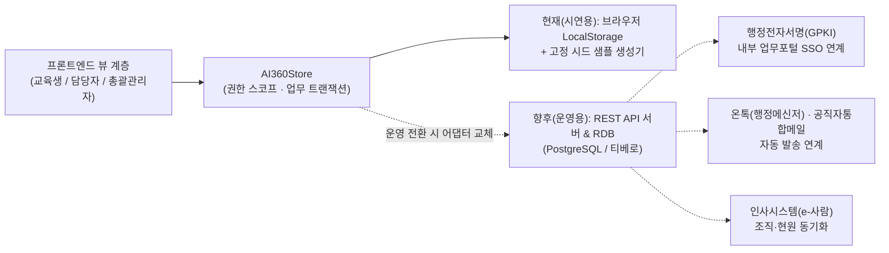

# AI 360 시스템 설계 명세서

---

## 1. 시스템 아키텍처 및 향후 실제 운영 확장 구조

현재 시연용 프로토타입은 별도 서버 없이 브라우저 내에서 완결 동작하도록 `Store Repository 패턴`으로 설계되었으며, 실제 운영 구축 시 뷰(UI) 변경 없이 데이터·연계 어댑터만 교체할 수 있도록 계층이 분리되어 있습니다.

---

## 2. 5단계 계층형 권한 설계

조직 계층(`소속기관 → 실·국 → 부서(팀) → 개인`)에 맞춰 엄격한 데이터 접근 제어를 적용합니다.

| 단계 | 권한 코드 | 대상 | 조회 가능 스코프 | 타 조직 데이터 접근 | 나의 화면 전환 |
| :--- | :--- | :--- | :--- | :--- | :--- |
| **1단계** | `student` | 전 직원 (교육생) | 본인(`employeeId`) | 불가 (전사 평균만 비교 표시) | 기본값 |
| **2단계** | `dept` | 부서 담당자 (부서당 1명) | 소속 부서 구성원 | 불가 (전사 평균선만 표시) | `관리 ↔ 나의 화면` 지원 |
| **3단계** | `bureau` | 실·국 담당자 (실·국당 1명) | 소속 실·국 산하 부서·개인 드릴다운 | 불가 (전사 평균선만 표시) | `관리 ↔ 나의 화면` 지원 |
| **4단계** | `org` | 소속기관 담당자 (기관당 1명) | 소속기관 산하 실·국·부서·개인 드릴다운 | 불가 (전사 평균선만 표시) | `관리 ↔ 나의 화면` 지원 |
| **5단계** | `admin` | 총괄 관리자 (교육 총괄) | 전 기관 전체 (1,000명) | 전체 열람·편집 가능 | `관리 ↔ 나의 화면` 지원 |

- **소규모 직속기관 처리 규칙:** 원본 인사데이터의 실국명이 `"-"`인 기관(경제자유구역기획단, 광업등록사무소, 마산·군산자유무역지역관리원, 동부광산안전사무소 등)은 내부 계층상 **`"(기관 직속)"`** 실·국 노드로 정규화하여 드릴다운 일관성을 보장합니다.
- **담당자 단일성 보장:** `org_managers` 테이블에서 동일 `level + unitKey`에 신규 담당자를 지정하면 기존 담당자는 즉시 해제됩니다.

---

## 3. 데이터 엔티티 명세 (`db` 스키마)

| 엔티티명 | 주요 필드 | 설명 |
| :--- | :--- | :--- |
| `employees` | `id, seq, org, rawBureau, bureau, dept, rank, name, is_sample` | 전 기관 직원 마스터 (샘플 1,000명) |
| `orgs` | `name, bureaus[{ name, depts[] }]` | 소속기관(7) → 실·국(22) → 부서(56) 트리 |
| `org_managers` | `id, level, unitKey, org, bureau, dept, employeeId, autoAssigned` | 조직 단위별 담당자 매핑 (단위당 1명) |
| `courses` | `id, title, purpose, targetType, topic, instructorName, date, startTime, endTime, hours, place, capacity, required, allowWalkIn, status` | 집합교육 마스터 및 7단계 상태 |
| `qr_codes` | `id, courseId, type(apply\|attend\|satisfaction), token` | 과정별 자동 발급 QR 3종 |
| `course_reports` | `courseId, plan{...}, report{..., photos[]}` | 공문서형 교육계획서 및 결과보고서(사진 최대 4장) |
| `notices` | `id, type, courseId, roundId, title, body, readBy[]` | 교육 안내·마감·진단 실시 알림함 |
| `enrollments` | `id, courseId, employeeId, enrolledAt, channel, status` | 교육 신청 내역 (포털/QR/현장신청) |
| `attendances` | `id, courseId, employeeId, checkedAt, method, manualReason` | QR 출석 인증 시각 및 관리자 수동 보정 사유 |
| `completions` | `id, courseId, employeeId, hours, completedAt` | 수료 및 인정 이수시간 집계 |
| `satisfaction_responses` | `id, courseId, employeeId, scores{S1..S5}, comment` | 수료자 만족도 5문항 + 자유의견 (1인 1회) |
| `assessment_rounds` | `id, title, periodStart, periodEnd, targetType, status` | 연 1~2회 역량 진단 회차 정보 |
| `assessment_items` | `id(Q1..Q7), domain, text, mappedTopics[]` | 7개 AI 역량 영역 진단 문항 및 추천 매핑 |
| `assessment_responses` | `id, roundId, employeeId, answers, domainScores, totalScore, grade` | 회차별 직원 진단 응답 및 산출 점수 |
| `reminders` | `id, actorId, actorName, targetCategory, targetCount, unitLabel, createdAt` | 미신청·미수료·미응답 독려 실행 이력 |
| `audit_logs` | `id, createdAt, actor, action, detail` | 주요 등록·변경·보정 감사 로그 |

---

## 4. AI 역량 진단 점수 산식 및 교육 추천 매핑

### 4.1 점수 산출 및 등급 기준
- **영역별 환산 점수:** $\text{영역 점수} = \frac{\text{응답 척도(1~5)} - 1}{4} \times 100$ (`0점, 25점, 50점, 75점, 100점`)
- **종합 점수:** 7개 영역 환산 점수의 산술 평균 (소수점 첫째 자리 반올림)
- **역량 등급 5단계:**
  - `90 ~ 100점`: **선도**
  - `75 ~ 89점`: **심화**
  - `60 ~ 74점`: **활용**
  - `40 ~ 59점`: **기초**
  - `0 ~ 39점`: **입문**

### 4.2 보완 영역별 추천 교육 주제 매핑
| 문항 | 진단 역량 영역 | 우선 매핑 교육 주제 (10대 분류) | 직급 가중 규칙 |
| :--- | :--- | :--- | :--- |
| **Q1** | AI 기본 이해 | `AI 입문`, `AI 정책·전략` | `과장` 직급은 진단 결과와 무관하게 **`관리자 AI 리더십`** 과정을 추가 추천 |
| **Q2** | AI 기획 | `산업 AI·제조 AX`, `AI 정책·전략` | |
| **Q3** | AI 도구 활용 | `생성형 AI 활용`, `AI 업무 자동화` | |
| **Q4** | 프롬프트 설계 | `프롬프트 엔지니어링`, `생성형 AI 활용` | |
| **Q5** | AI 결과 분석·검증 | `프롬프트 엔지니어링`, `AI 에이전트` | |
| **Q6** | 데이터 활용 | `데이터 분석`, `바이브코딩` | |
| **Q7** | AI 윤리·보안 | `AI 입문`, `AI 정책·전략` | |

